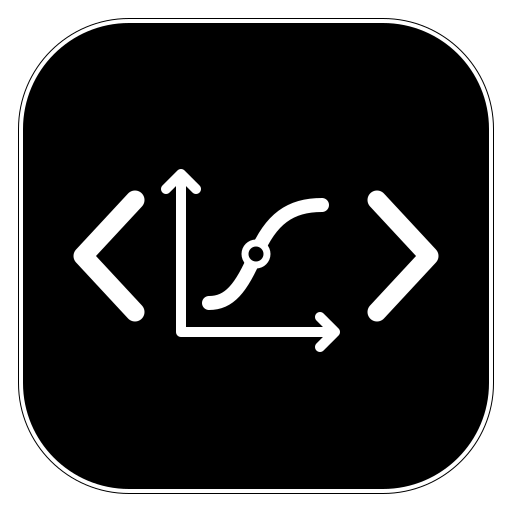

# TikZ Native



Render TikZ code blocks as SVG in Obsidian Desktop using your local LaTeX installation. TikZ Native supports snippets and full LaTeX documents, automatic PDF-to-SVG converter fallback, and transparent diagrams that adapt to dark mode without recompilation.

Choose **Language / 界面语言** in the TikZ Native settings to switch between English and Simplified Chinese. New installations default to English. Existing saved settings without a language preference start in Chinese. Switching updates the interface without recompiling diagrams. Compiler and converter logs retain their original text.

## Requirements

- Obsidian Desktop.
- A local TeX distribution with TikZ and the `standalone` class. LuaLaTeX is the default and supports TikZ graph drawing. XeLaTeX and pdfLaTeX are also supported.
- One PDF-to-SVG converter. Use MuPDF (`mutool`), Poppler (`pdftocairo` and `pdfinfo` in the same directory), or `dvisvgm` with a working PDF backend. If discovery fails, enter the executable paths in the plugin settings.

## Install from GitHub

1. Download `main.js`, `manifest.json`, and `styles.css` from the GitHub release.
2. Put them in the `.obsidian/plugins/tikz-native/` folder of your vault. Create the folder if needed.
3. Reload Obsidian and enable **TikZ Native** under **Settings → Community plugins**. Disable TikZJax or any other plugin that also registers `tikz` blocks.
4. In TikZ Native settings, turn on **Enable local compilation** (开启本地编译) for a vault whose content you trust. Use **Check compilation environment** (检查编译环境) to test the setup.

## Usage

````markdown
```tikz
\begin{tikzpicture}
  \draw[->] (0,0) -- (3,0) node[right] {$x$};
  \draw[blue,thick] (0,0) parabola (2,2);
\end{tikzpicture}
```
````

Use `tikz` or `tikz-native` as the code block language. For a different compiler, add a directive such as `% !TeX program = xelatex` to the block and leave the executable path blank. Declare any extra packages in the block or in the plugin's preamble setting. Relative TeX inputs, CSVs, and images are resolved from the note's directory and the usual TeX search paths.

## Local compilation and privacy

Local compilation is off by default. When enabled, viewing a TikZ block can run the locally installed LaTeX engine and PDF converter. Only enable it in vaults where you trust the notes, including notes you import or receive through sync. The plugin passes `-no-shell-escape` to LaTeX. TeX and embedded Lua still run with your user's permissions and can access files outside the vault. This compiler setting is only one restriction on what the source can do.

The plugin locates system executables, writes compilation artifacts to an OS temporary directory, and checks the metadata of recorded inputs to invalidate cached diagrams. LaTeX may read system packages, fonts, or files referenced by a document. The plugin itself makes no network requests and sends no telemetry. Install dependencies separately, and configure your TeX distribution to avoid automatic package downloads if you need offline operation.

## 中文快速入门

把 Release 的三个文件放进笔记库的 `.obsidian/plugins/tikz-native/`，重载 Obsidian 并启用插件。在 TikZ Native 设置顶部选择「界面语言 / Language → 简体中文」。仅在信任所有相关笔记的库中打开「开启本地编译」，再点「检查编译环境」。需要本机 LaTeX 和 PDF 转 SVG 工具。详情见 [兼容性示例](examples/兼容性示例.md)。

## Build and test

```sh
npm ci
npm run build
npm test
npm run test:integration
```

The build uses Node.js 18 or later and combines the source modules into `main.js`. The npm dependency is used for tests. Integration tests require a local TeX installation and a working converter. The initial public build was checked on macOS.

## License

MIT. TikZJax by [artisticat1](https://github.com/artisticat1/obsidian-tikzjax) inspired compatibility with its `tikz` code block format. TikZ Native uses locally installed TeX and converter programs.
